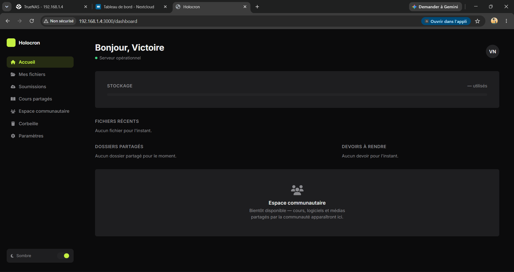
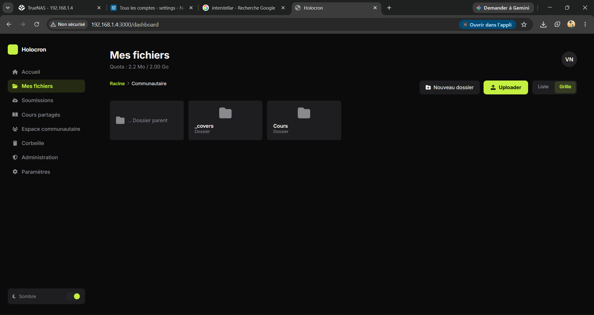
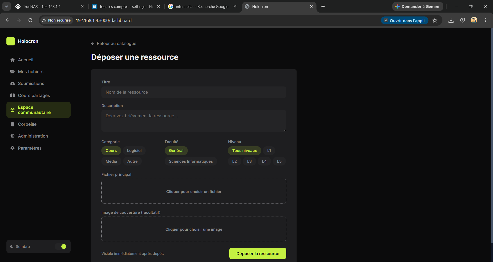
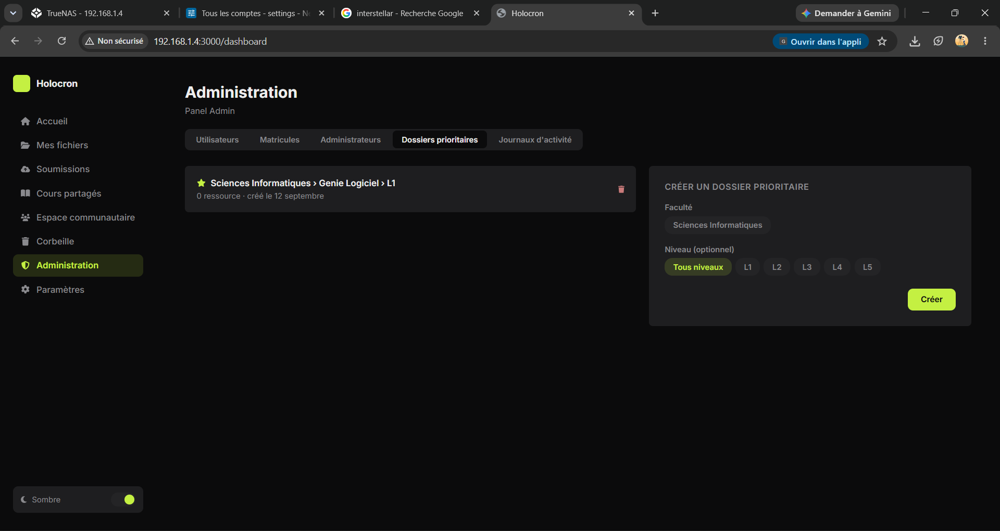

# Holocron

Holocron is an academic file and submission management platform, designed for a campus or institutional environment. It combines:

- a React frontend for the user interface,
- a Node.js / Express backend for the API,
- a MySQL database for application logic,
- a Nextcloud integration for storage, shared folders, and WebDAV,
- a Docker orchestration for local or server deployment.

The project includes features for managing users, academic programs, assignments, submissions, community resources, quotas, as well as an advanced administration space.

## Screenshots

| Dashboard | File Explorer |
|---|---|
|  |  |

| Community Space | Administration |
|---|---|
|  |  |

## Project overview

The system is structured around several building blocks:

- authentication and account management,
- student ID (matricule) validation,
- assignment creation and tracking,
- submission upload and review,
- storage quotas and Nextcloud shared folders,
- community space with resources, categories, and reports,
- notifications and activity logging,
- administration with granular permissions.

## Tech stack

### Frontend
- React 18
- React Router DOM
- Axios
- CRA / react-scripts

### Backend
- Node.js
- Express
- MySQL2
- JWT
- bcryptjs
- Multer
- CORS, Helmet, express-rate-limit

### Infra / DevOps
- Docker
- Docker Compose
- Nextcloud
- PostgreSQL for the Nextcloud database
- Redis

## Repository structure

```text
.
├── .gitignore
├── .vscode/
├── backend/
│   ├── Dockerfile
│   ├── package.json
│   ├── package-lock.json
│   └── src/
│       ├── config/
│       ├── controllers/
│       ├── middleware/
│       ├── routes/
│       ├── utils/
│       └── index.js
├── database/
│   └── init.sql
├── frontend/
│   ├── Dockerfile
│   ├── nginx.conf
│   ├── package.json
│   ├── package-lock.json
│   ├── public/
│   └── src/
│       ├── App.jsx
│       ├── Home.jsx
│       ├── index.js
│       ├── index.css
│       ├── components/
│       ├── context/
│       ├── pages/
│       ├── services/
│       └── theme/
├── nexcloud/
│   └── docker-compose.yml
├── docker-compose.yml
├── holocron-boot.sh
├── RECONSTRUCTION_ET_DEPLOIEMENT.md
└── README.md
```

## Key features

### Authentication and accounts
- user registration,
- student ID (matricule) validation,
- Nextcloud password storage,
- roles: student, professor, assistant,
- administration permission management.

### Assignment and submission management
- assignment creation by professors/assistants,
- assignment by academic program,
- one submission per student per assignment,
- submitted file storage,
- professor / assistant review.

### Community space
- resources shared by category,
- program / level / faculty as classification dimensions,
- priority folders,
- resource reporting,
- content verification logic.

### Shared storage / Nextcloud
- integration with Nextcloud for user accounts,
- shared folders,
- quotas,
- direct reading of Nextcloud data on the backend side for certain business operations.

### Administration
- activity log,
- delegated admin permissions,
- student ID (matricule) management,
- user and resource oversight.

## Data model

The main MySQL database contains, among others, the following tables:

- `matricules`
- `users`
- `sessions`
- `assignments`
- `submissions`
- `admin_permissions`
- `activity_logs`
- `faculties`
- `levels`
- `faculty_filieres`
- `community_categories`
- `community_priority_folders`
- `community_resources`
- `community_reports`
- `notifications`

The `database/init.sql` file contains the schema and demo seed data.

## Deployment

### With Docker Compose

The repository provides a main `docker-compose.yml` for the webapp stack:

```bash
docker compose up -d --build
```

The Nextcloud stack is separate, in `nexcloud/docker-compose.yml`:

```bash
cd nexcloud
docker compose up -d
```

The `holocron-boot.sh` script is intended to handle a more robust server startup, notably for the Docker data-root configuration and a data pool.

## Local setup

### Prerequisites
- Docker
- Docker Compose
- Node.js / npm
- (for backend development) access to a local MySQL database or to the project's Docker stack

### Backend
```bash
cd backend
npm install
npm run dev
```

### Frontend
```bash
cd frontend
npm install
npm start
```

### Default access
- Frontend: http://localhost:3000
- Backend API: http://localhost:5000
- Nextcloud: http://localhost:8080

## Environment variables

The backend expects variables such as:

- `DB_HOST`
- `DB_USER`
- `DB_PASSWORD`
- `DB_NAME`
- `NEXTCLOUD_URL`
- `NEXTCLOUD_ADMIN`
- `NEXTCLOUD_PASSWORD`
- `JWT_SECRET`
- `NC_DATA_DIR`

Values are configured in `docker-compose.yml` for a local / internal server deployment context.

## Important notes

- The project contains configuration elements and credentials tied to an internal academic environment.
- The repository includes sensitive deployment or infrastructure information (passwords, Docker volumes, system locations).
- The `RECONSTRUCTION_ET_DEPLOIEMENT.md` file explains in detail the project's reconstruction after a disk loss and describes the target architecture / redeployment.
- The project is still a development / reconstruction project with points to verify before a hardened production rollout.

## Project status

The repository appears to correspond to a reconstruction and redeployment state of an already-existing application, with:

- a defined functional architecture,
- database schemas already prepared,
- fairly advanced business logic,
- a need for validation and cleanup before production.

## License

Distributed under the [Apache License 2.0](LICENSE).

## Author / owner

The repository is hosted under the GitHub account [VictoireNdala](https://github.com/VictoireNdala/Holocron) and is public.

## Future development / roadmap

The reconstruction notes mention several points to finalize or verify, notably:

- advanced file deletion / management,
- API-side password change,
- full wiring of shared folders in the dashboard,
- UI/UX improvements,
- local AI integration if needed.

## Useful resources

- `RECONSTRUCTION_ET_DEPLOIEMENT.md`: reconstruction and redeployment documentation
- `database/init.sql`: main schema and seeds
- `docker-compose.yml`: webapp stack configuration
- `nexcloud/docker-compose.yml`: Nextcloud stack configuration
- `backend/src/index.js`: API entry point
- `frontend/src/App.jsx`: frontend entry point

## Conclusion

Holocron is an academic platform project integrating storage, assignment management, submissions, community, quotas, and administration. It is a solid foundation for a campus file and activity management system, with a modern architecture based on Docker, React, and Node.js.
